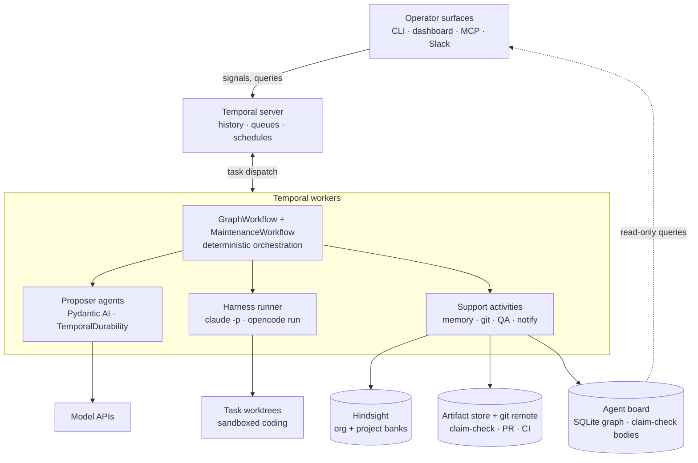
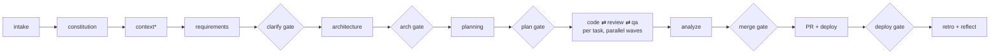
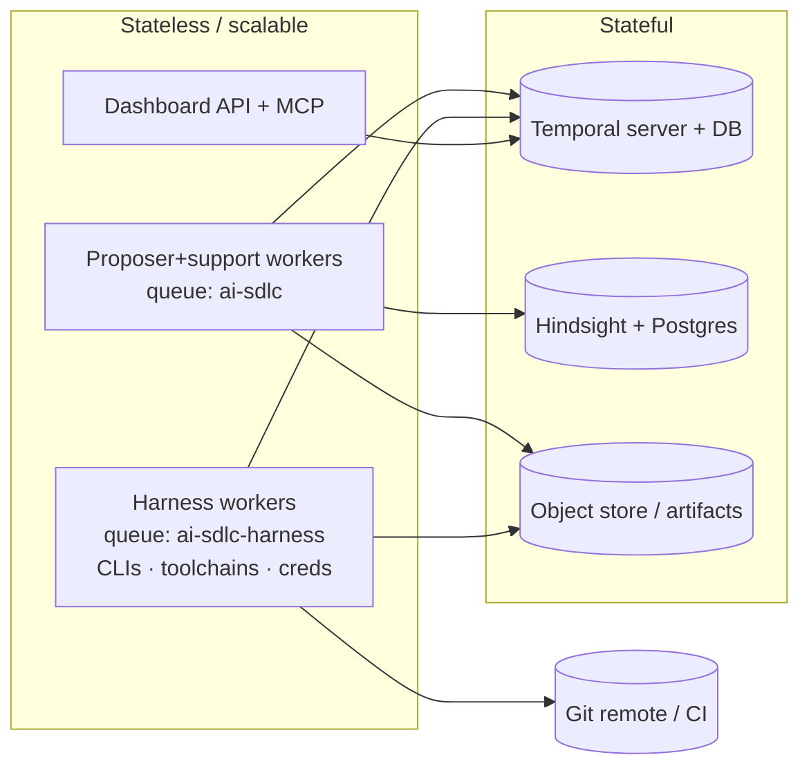

# Architecture — Agentic SDLC Factory

| | |
|---|---|
| Status | Draft v1.0 |
| Date | 2026-07-02 |
| Last amended | 2026-10-11 — direction set by the agent architecture plan: target blocks in §§1–6, 8–11, 13; ADR-2/6/9/12 amended; ADR-22…24 added; §9 and §14 corrected to the one queue `main` runs. 2026-09-01 — the crew, a multi-agent code stage (§§2, 3, 4; E-88); §14 regenerated from `main`; §7 marked P4/unbuilt |
| Direction | `docs/reports/Kroker Agent Architecture & Implementation Plan.md` (2026-10-04, revised 2026-10-11 with scaling, SDK portability and run UI) is the priority document. Where this file and the plan disagree, the plan wins and this file moves toward it |
| Related | `PRD.md`, `SDLC-spec-v2.md`, `ROADMAP.md`, `BENCHMARK.md` — contracts in `src/sdlc/models.py` are the source of truth |

> **Reading target blocks.** A paragraph opening with **Target (plan, not
> built)** states where the architecture is going, in the plan's terms and
> by the plan's phases, written `AP-0`…`AP-6` and tracked in
> `docs/roadmap/agent-architecture-plan.md`. Everything outside those
> blocks describes `main`. A target block becomes plain text when its phase
> lands; until then `ROADMAP.md` carries it as open.

---

## 1. Overview

The factory is a deterministic state machine over a fixed 15-stage DAG,
executed as a Temporal workflow. Specialized agents fill roles; humans hold
configurable decision gates; a shared memory makes the system learn across
runs; a proactive maintenance loop closes the circle from deployed feature
back to new work.

Two rules shape everything:

1. **The model never acts outside a sandboxed, observed boundary.**
   Proposer agents emit schema-validated artifacts and never touch tools.
   Coding harnesses act, but only inside risk-classed git worktrees, and
   only their diff is admitted as an artifact.
2. **Memory is I/O.** All memory access happens in activities; recall
   results become persisted, hashed `RecallSnapshot` artifacts declared as
   stage inputs — stages stay pure functions of hashed inputs.

**Target (plan, not built):** the system is a **deterministic workflow of
bounded ReAct agents** (ADR-22). Rule 1 narrows from "proposers never touch
tools" to "no role acts outside a boundary the runtime enforces": proposer
roles gain **read-only** repository tools pinned to a commit, with a step
budget, and still cannot write, run arbitrary commands, or see another
role's session. A third rule joins the two above:

3. **Model observes, code decides.** A model returns per-item observations
   with evidence; every boolean a gate or loop reads (`approve`,
   `tests_passed`, `stack_mismatch`, `plan_valid`) is a pure function in
   code (ADR-24). Anything checkable inside the conversation is an output
   validator that sends the model back, not an outer re-run.



Nothing below the worker reaches upward: worktrees, memory, and stores are
passive endpoints. A misbehaving harness influences orchestration only
through its validated diff artifact.

## 2. Component responsibilities

| Component | Owns | Never does |
|---|---|---|
| Temporal server | run state, event history, timers, signals, schedules, visibility | business logic |
| GraphWorkflow (FeatureWorkflow retained for in-flight runs) | stage sequencing, gate waits, fix-loop bounds, budget counters | I/O, subprocesses, memory, nondeterminism |
| MaintenanceWorkflow **(P4 — designed, not built)** | DAPER cycle, repair gating, child factory runs | direct code patches |
| Proposer agents | typed artifact proposals (Requirements … RepairPlan) | tool calls, file access. *Target (plan, not built):* owns typed evidence gathered with read-only repo tools; never writes, never runs unlisted commands, never computes its own verdict |
| Harness runner activity | `claude -p` / `opencode run` execution, heartbeats, checkpoint commits, cost capture | leaving the worktree; choosing its own permissions |
| CrewTaskWorkflow (E-88) | the code stage's round loop when a task runs as a crew: turn order, the four brakes, per-round checkpoints, its own `tool_approval` / `crew_question` gates | subprocesses and file I/O (every turn is an activity); writing repository files through any role but the lead |
| Support activities | Hindsight retain/recall/reflect, worktree/PR ops, test/lint/coverage runs, notifications | decision-making |
| Deterministic stages | constitution, quality gate, summary/export | LLM calls |
| Hindsight | world facts, experiences, mental models per bank | overriding validators or contracts |
| Artifact store | specs, diffs, reports, recall snapshots (claim-check) | — |
| Agent board | project-level artifact versions + lineage, task status lifecycle, append-only change log | deciding anything; being the source of truth for what a run did |
| Operator surfaces | rendering queries, sending signals | owning state (no interface DB) |

## 3. Pipeline architecture

Stage DAG (SDLC-spec v2 §1). One `GraphWorkflow` per run, executing a pinned
`PipelineGraph` (E-74); the code stage fans out per-task child work in
dependency-ordered parallel waves. Rollback of E-74 is roll-forward only:
there is no start-site switch back to FeatureWorkflow.


*context runs only in brownfield mode (Cartographer → `CodebaseMap`; the
Architect then produces a delta: added/modified/removed against real
modules). Greenfield skips it and the Architect owns stack + file tree.*

**Per-task loop (creator/verifier discipline):** at planning time, each
task's acceptance criteria are compiled into a frozen **Validation
Contract** — machine-checkable assertions defined before any code exists, so
correctness is measured against requirements rather than implementation
bias. Then: worktree + branch per task → harness session implements → tests
run → validators judge **against the contract**. Validators (Reviewer, QA
analyst) are *clean-context*: they receive task + contract + materialized
diff + test output, never the worker's session or self-reported narrative.
On failure the same harness session resumes with the issues (bounded,
default 2 review / 3 QA repairs) — but sessions carry a **resume bound and
context ceiling**: past either, the factory starts a fresh session seeded
with a structured handoff, because a compacted session has lost the
reasoning thread and is treated as failed. Exhaustion escalates to a human
task gate (accept / retry with guidance / quarantine). Every harness run
ends with a checkpoint commit (a failed one is logged at WARNING, not raised),
and every completed task emits a `HandoffSummary` (what changed, decisions, open concerns) consumed by
subsequent tasks and the merge stage.

**Target (plan, not built) — the per-task loop decides on evidence:**

- **Planning splits in two.** The planner decomposes with repo tools into
  task skeletons (`covers`, `files_hint`, `depends_on`); one call per task
  then compiles its Validation Contract. Code checks the DAG, id
  uniqueness, requirement coverage and task size, and dry-runs every
  contract command on an empty worktree — a command that does not exist is
  a plan error, found before any code is written.
- **Tests come first.** The test harness writes tests from the contract and
  the test freeze (C2) locks them; code checks they exist and fail before
  implementation.
- **The developer's definition of done is the contract's commands.** A
  wrapper refuses hand-off unless `test_commands` and `lint_commands` exit 0.
- **QA traces evidence.** It returns one `AssertionEvidence` per contract
  assertion (met / unmet / unverifiable, with the test and implementation
  location), using read-only repo tools and `run_single_test`.
  `tests_passed` and `stack_mismatch` are computed from that list.
- **The reviewer is four parallel lenses** — correctness, test integrity,
  integration, security — on another model family. Each `Finding` carries
  `path`, `line` and a quote; a validator drops any finding whose quote is
  not at that location. `approve` is computed: no critical or high finding
  and no unmet assertion.
- **A regression check** reverts the implementation for a key assertion and
  requires its test to fail.
- **The fix loop carries a task ledger** — attempts, commands run, failing
  tests, unmet assertions, findings — so a retry does not repeat a failed
  approach, and receives the full failures section rather than a
  truncated tail. The bound stays at 2 attempts until the loop is shown to
  converge.
- **Roles removed or merged:** `devops_planner` folds into planner
  decompose; `adversary` gives way to two samples of the correctness lens,
  with disagreement going to a human; `merge_verdict` stops advising and
  becomes a release summary for the person at the merge gate.

**Target (plan, not built) — the roles around the loop:**

- **Architect** gathers evidence with repo tools and returns
  `requirement_coverage`; the brownfield delta check becomes a validator on
  its output. A critic on another family reviews requirements and spec
  only; one blocking critique triggers one revision round.
- **Clarify probes** read the repo; their questions are deduplicated and
  ranked by `materiality` in code before they reach the inbox.
- **Analyst** becomes an aggregator: the trace matrix over all
  `AssertionEvidence` is built in code, and the model is called only for
  cross-task issues and `unverifiable` items.
- **Research** fetches pages as numbered fragments; every claim cites a
  `fragment_id`, and a validator rejects any citation of a fragment that was
  not fetched.

**One session or a crew (E-88):** a task's implementation is by default one
harness session driven by an activity. It may instead run as a **crew** — a
`CrewTaskWorkflow` child holding a round loop, where a round is *lead turn →
critic turn → read the round's files → decide*. The round machine lives in
workflow code and every turn is an activity, so a lost worker costs one round
rather than a task: each round ends in a checkpoint commit. `HarnessKind.CREW`
is a **composition mode, not a CLI** — each role still names one of the real
harnesses — so the crew is selected per role config (`harness: crew`, `layout:
<name>`) and everything upstream and downstream of the stage is unchanged: the
child returns the same `HarnessRunResult` the single-session path returns.

**Execution mode:** implementation defaults to **serial** — parallel
implementers make divergent design decisions even with worktree isolation
(worktrees prevent file collisions, not architectural inconsistency).
Projects may enable dependency-ordered `waves`; the planner declares
module/file overlap and overlapping tasks serialize regardless. Read-only
work (review, analysis) always parallelizes freely.

**Integration by running branch (ADR-14):** worktrees isolate but do not
compose — a dependent task must *see* its predecessors' code, not just a
prose handoff. So each run holds one `sdlc/<run_id>/integration` branch,
created from `base` at run start, that accumulates completed task work. A
task branches from the *current integration head* (in wave mode, the head
frozen at wave start); on clean-context QA pass, an activity merges the task
branch back into integration. The merge-gate PR is `integration → base` —
resolving the parallel-branch/one-PR question (was OQ-2) as continuous
integration onto a run branch. Validator diffs anchor to the branch point,
not `base`, so a dependent task's diff shows only its own change. A wave-mode
merge conflict is a *falsified `overlaps` declaration* — now detectable →
serialize the loser or escalate. Integration fixes visibility, **not**
divergence; divergence remains serial-by-default's job.

**Incremental re-runs — auditability vs memoization (ADR-5):** two things
the specs used to conflate. *Auditability* is the invariant: persisted
artifacts, RecallSnapshots, and Temporal history reconstruct every run.
*Memoization* is a best-effort dev-loop optimization — re-running a fixed
idea after a prompt/config edit skips unchanged **upstream** stages (its ROI
is bounded: the expensive code stage is usually downstream of the edit and
re-runs anyway). Temporal gives none of this for free, so a `memoization`
module owns a content-addressed activity cache keyed on
`hash(activity + inputs + prompt file + model id + upstream recall snapshot ref)`,
backed by the artifact store (hash-named keys, no new infra). Recall is
itself a cached activity keyed with a **per-run memory watermark**: reusing
the persisted RecallSnapshot *is* the freeze, so nightly `reflect` churn no
longer busts caches. Default re-run reuses the watermark (reproducible,
cache-warm); an explicit "refresh memory" advances it. This also removes any
need for Hindsight point-in-time reads.

## 4. Agent architecture

Agent classes map to Temporal constructs (this is a rule, not a convention):

| Class | Construct | Ours |
|---|---|---|
| Automation (one LLM call) | activity via the TemporalDurability capability | Product, Clarifier, Architect, Planner, Reviewer, Analyst, QA analyst, MergeVerdict, detector, repair planner |
| Long-running (tools, iteration) | heartbeating activity | Developer / Resolver harness runs; optional Reviewer *deep-review* tier |
| Conversational | external client ↔ workflow signals/queries | operators via MCP/dashboard |
| Proactive | workflow (timer loop / Schedule) | nightly reflect; MaintenanceWorkflow **(P4, unbuilt)** |
| Routing | deterministic workflow branch | intake (greenfield / brownfield / repair) |

Agents are configuration (`config/agents.yaml`): role → kind
(proposer|harness), model, prompt file, memory policy (banks, filters,
top_k, retain kind). The loader builds Pydantic AI `Agent`s with declared
`output_type` and attaches the `TemporalDurability` capability to every
proposer — model calls and tool I/O offload to activities automatically.
Constraints enforced at load: agent/toolset names are Temporal activity
names (rename = breaking change); a role that drops or weakens the
capability fails registry load (003); developer and reviewer must differ in
harness or model family.

**Target (plan, not built) — one factory, bounded ReAct roles:** every role
is built by `make_agent(role_spec, output_type, tools, validators)` from the
same parts, so a new role is configuration plus a prompt.

| Part | What it is |
|---|---|
| `RoleSpec` (in `agent.yaml`) | model id and family, thinking budget, max tokens, step and tool-call budget, retries, task queue, SDK |
| `RepoReadTools(root, commit)` | `read_file`, `grep`, `list_dir`, `git_show`, `find_tests` — read-only, commit-pinned, truncated with paging |
| `SandboxTools` | `run_command`, `run_single_test` in an isolated worktree, budgeted and allowlisted |
| Validators library | `paths_exist`, `quote_in_file`, `ids_unique`, `dag_acyclic`, `covers_all`, `fragment_was_fetched` |
| Evidence schemas | `AssertionEvidence`, `Finding`, `Coverage` — evidence fields before status fields |
| Verdict functions | pure, unit-tested: `review_verdict`, `plan_verdict`, `task_verdict` |
| `ModelRouter` + family check | resolves role to model; start-up fails when a judge shares dev's model (ADR-6) |

The class table above changes with it: architect, planner, QA, reviewer
lenses, clarify probes and analyst move from *one LLM call* to a bounded
tool loop inside one activity; critics, handoff and the release summary stay
single calls. When a role's step budget is spent its tools are removed, so
it must return its structured output. Read-only roles never get a shell;
anything that runs commands sits in a sandbox workspace.

One constraint shapes the validators: a role's loop runs in workflow code
(`workflows/role_host.py`), where file access is not allowed. A validator
that reads the tree (`paths_exist`, `quote_in_file`) therefore runs in an
activity and returns its failure to the conversation; only validators over
the output alone (`ids_unique`, `dag_acyclic`, `covers_all`) run inline.

**Target (plan, not built) — tools and hooks per role.** Every role gets the
smallest toolset that lets it check its own claims, and the runtime — not
the prompt — enforces its limits. A baseline attaches to every role through
`make_agent`: tracing, thinking at the role's effort, tool-output limits,
spend limits; a start-of-run check of the ADR-6 family rule; tool removal
once the step budget is spent; tool errors sorted into *retry* (transient)
or *failed result* (definitive, the model adapts), anything else aborting.

| Role | Tools | Enforced beyond baseline |
|---|---|---|
| clarify probes | read-only repo | every `evidence` path exists |
| architect | read-only repo, `git_show`, `research` | delta valid against the git tree; every requirement covered; each decision lists alternatives |
| critics | none | family differs from dev (ADR-6) and from the role it critiques |
| planner decompose | read-only repo, `find_tests` | DAG acyclic, ids unique, coverage, size thresholds |
| contract compile | read-only, manifests only | each command references an existing script; dry-run is an orchestrator activity, not a tool |
| test harness | write in sandbox | writes outside test paths cancelled; network and `git push` denied |
| dev harness | write in sandbox | frozen tests and CI config read-only, edits cancelled with a reason; hand-off refused unless contract commands exit 0 |
| QA | read-only repo, `run_single_test` | call cap; test names must come from the diff or test output |
| reviewer lenses | read-only repo, `git_show`; no shell | finding's quote must be at `path:line` |
| deep_review | none; its input is the scrubbed transcript | runs on orchestrator signals only |
| analyst | read-only on the integration branch | every criterion in the trace matrix or flagged `unverifiable` |
| research | search, numbered-fragment fetch, prompt-injection screening | every cited fragment was fetched |
| handoff, release summary | none | — |

File-tool roots bound file tools only, never a shell, so any role that runs
commands lives in a sandbox workspace.

Beside durability every durable proposer (and the research stage's
activity-side planner/synthesis agents) carries the single-retry resolver
(`agents/model_ids.py::single_retry_layer`, 004): the provider client is
built with its SDK retries off, so one model request costs at most its
agent's engine attempt budget of HTTP calls — the workflow engine is the
only retry layer. Per-run proposer overrides (`--role-model role=provider:model`,
benchmark arms, graph node roles) are validated offline at submission
(unknown provider, malformed string → refused before anything starts) and
**forwarded to the call** from `RoleHost._run_role` via
`agents/model_ids.py::forwarded_model` — the model that answers, the label,
the priced model and the memo key all name the override, and a call site
whose label disagrees fails non-retryably instead of recording a wrong
label. Runs without overrides are byte-identical to before (replay-safe).

Since 005 the 11 glm proposer roles ship `zai:glm-5.3` and are served on
z.ai's native **coding** endpoint (the subscription-covered one):
`agents/model_ids.py` owns the base-URL policy — `ZAI_CODING_BASE_URL` by
default, a non-blank `ZAI_BASE_URL` overrides it, read at call time — and
every site that turns a model string into a model applies it through
`single_retry_layer` / `route_layer` / `resolve_model` (the durable loader
path, the loader-only/eval path, the eval runner, the benchmark judge and
the operator chat; `tests/test_model_construction_sites.py` pins the site
list). The claude roles keep the Anthropic-compatible endpoint; per-role
rollback is `--role-model <role>=anthropic:glm-5.2`.

**Context engineering (handles, not walls of text):** agent context is
assembled from references and scoped extracts, never full artifact dumps —
the Developer gets its task, the relevant `CodebaseMap` slice, and contract
refs; the Clarifier never sees code; no agent sees another stage's raw
transcript. Each role declares a context budget in `agents.yaml`, enforced
at prompt assembly. This is the prompt-side counterpart of the claim-check
rule: history payloads stay small by reference, and agent reasoning stays
sharp by scope. High-volume exploration (the Cartographer walking a large
repo) uses programmatic access — tools that filter and extract — rather
than streaming the corpus through the context window.
*Target (plan, not built):* "no agent sees another stage's raw transcript"
holds unchanged; what changes is that a role may read the repository at
the task's commit through its read-only tools instead of receiving a
pre-built extract. Reading code is evidence gathering, not context
sharing. "The Clarifier never sees code" goes with it: clarify probes read
the repo so each question can cite the path that raised it.

**Model tiering per role:** capability-matched, configured per agent, cost
attributed per role per run (SC-7 feeds tiering decisions):

| Role | Capability need | Tier |
|---|---|---|
| Architect, Planner, repair planner | strategic reasoning | frontier reasoning model |
| Developer, Resolver | code fluency + tools | code-optimized (harness-native) |
| Reviewer, QA analyst | adversarial instruction-following | **different model family than the developer's authoring model** |
| Clarifier, detector, Cartographer triage | narrow classification/extraction | small fast model |

**Target (plan, not built) — tiers by where an error multiplies:**

| Tier | Roles | Family rule | Thinking |
|---|---|---|---|
| Strong judge | reviewer lenses, architect critic, plan critic | must differ from dev | on |
| Strong planner | architect, planner decompose | any; prefer strong | on |
| Worker | dev and test harness, QA, contract compile, clarify probes | any | off or low |
| Cheap | handoff, release summary, analyst gap-filling, research fetch/cite | any | off |

With budget for one upgrade, the reviewer moves to a different strong family
first, then the planner. A model swap is measured separately from a prompt
change.

**Harness abstraction:** one protocol, three CLI adapters (claude_code,
opencode, cursor) plus the crew composition.
`claude -p <prompt> --output-format json --allowedTools … --resume <sid>` and
`opencode run [-m provider/model] [-s sid] [--attach url] --format json
<prompt>`. Adapters normalize to `HarnessRunResult{session_id, exit_code,
summary, cost_usd, commit_sha, input_tokens, output_tokens, context_window,
compacted, session_ref, session_digest}` — the token fields (already present in the harness
result JSON) make the ADR-13 context ceiling measurable rather than a blind
resume count. `session_ref: ArtifactRef{kind: harness_session}` is a
claim-checked, scrubbed **canonical `HarnessSession`** (normalised transcript
— tool-calls, file reads/writes, commands + exit status, model turns);
captured on every run (ADR-16), it is what makes *how* a diff was reached
measurable, not just the diff. `session_digest: SessionDigest` travels
**inline** (not claim-checked — it is small and bounded) carrying the §4.3
waste aggregates + decision-skeleton, computed pre-truncation so it exists
for every run including ones whose full transcript is later downgraded.
Green (first-pass) runs keep a structured
`SessionDigest` (waste aggregates + decision-skeleton) rather than the full
transcript; fail / benchmark / retried runs keep the full session (§4 waste
aggregates are computed pre-truncation, so they exist for every run). Sessions resume across fix-loop attempts,
preserving the agent's working context. Permissions live in native harness
config, not prompts.

**Reviewer is a clean-context proposer by default (ADR-6/ADR-12):** it emits
a typed `ReviewReport` from orchestrator-assembled inputs (materialized diff
+ frozen contract + test output + scoped `CodebaseMap` extracts) and holds no
tools, repo, or worker session — so it *cannot* wander or be polluted. The
doer has tools; the judge does not. A harness **deep-review** tier is
configurable per project/task for high-risk work; when enabled, the
harness-inequality clause re-applies to that path.

**Target (plan, not built) — read access, not reasoning access:** clean
context comes to mean *no view of the developer's session or narrative*.
Judges gain read-only access to the worktree at the task's commit, so they
check a claim instead of guessing at it; they still hold no write tool and
no shell. `deep_review` runs only on orchestrator signals (test edits, many
reverts, drift), not as a standing tier.

**Target (plan, not built) — SDK portability:** Kroker owns each role's
contract and an AI SDK is an adapter behind a `RoleRunner` port, the same
shape the coding harnesses already have (ADR-23). Kroker-owned: role input
and output schemas, tool definitions, validators, verdict functions, the
retry-with-error loop, the event schema, tool policy, model identity and
cost. The adapter calls the model, translates tools and maps events.
pydantic-ai stays the only adapter until a second one has a reason.

**The crew (E-88), when one harness session is not the unit of work.** A crew
is assets, not code: `crew/roles/<name>.yaml` declares a role's harness, model,
skill, and whether it `writes`; `crew/layouts/<name>.yaml` assembles roles with
a round bound, a deliverable, and limits. Three rules hold it together:

- **Exactly one role writes repository files, and it is the lead** — otherwise
  the diff stops being attributable to a role.
- **Every non-lead role differs in model family from the lead** (ADR-6, the
  reviewer rule applied to the crew). Checked when the crew loads and again in
  a client-side pre-flight; a model string carrying no provider separator is
  rejected, because family comparison would otherwise be meaningless.
- **A role's harness must be installed.** The worker refuses to boot on a crew
  whose CLI is missing, rather than discovering it one billed agent into a run.

**The fence is an argument, not a new predicate.** Non-lead roles keep `cwd` at
the worktree — a critic must read the code it is criticising — and set
`HarnessRequest.write_root` to their orchestration subtree, which becomes the
containment hook's confinement root. The shipped `no-out-of-worktree-write`
rule does the work unchanged. Its honest limit: that rule is hook-layer, so a
non-lead role on a harness with no hook layer is not confined by it and, under
`containment_strict`, refuses — which makes containment a statement about a
crew's *composition*.

**Round files are untrusted input.** Roles communicate through
`.workspace/orchestration/<layout>/round-N/`: `notes-v1` (the lead's
deliverable, which fills `HarnessRunResult.summary`), `advisor-v1` and
`review-v1` (the critic, read by the next round's brief), and `question-v1`
(any role, which raises a gate). Each is exact-schema and size-capped, an
unknown `schema` value is a hard error rather than a best-effort parse, and
contents are data — never instructions.

**A crew stops for a human without leaving the child.** `CrewTaskWorkflow` is
a `GateHost`, so a contained turn's `deferred` tool escalation and a role's
`question-v1` both become ordinary pending decisions answered by the existing
signals. Each carries `parent_run_id`, so the inbox groups a crew's gate under
the run it belongs to while the fleet view keeps listing runs, not children.
Four brakes bound the loop: wall clock, per-turn timeout, cost cap, and the
round bound, with a separate budget on escalations.

## 5. Human-in-the-loop architecture

A gate is a durable signal wait with policy:

```
policy: hard  -> always wait for human
        soft  -> auto-approve iff proposal.confidence >= threshold
                 AND deterministic checks pass; else wait
        off   -> proceed
```

A decision carries an **outcome ∈ {approve, reject, revise}** (not a bare
boolean): `approve` proceeds, `reject` is terminal, `revise` feeds `guidance`
back into the agent's next-round inputs. Revisable gates (clarify,
architecture, plan) run a **bounded revision loop**; exhaustion escalates to
a hard accept-anyway / abandon gate. This one contract collapses
architecture-revise, task-retry-with-guidance, and repair-approval into a
single shape (ADR-4).

Mechanics: entering a gate publishes an entry to the `pending_decisions`
query, fires a notify activity (Slack/email with deep links, retried), and
parks on `wait_condition`. Gate identity is `(gate_name, round)` so each
revision round is its own wait. Signals (`submit_gate_decision`,
`answer_question`) are idempotent — first decision *per round* wins — so
multiple surfaces cannot conflict and re-review is still possible. Durable timers drive reminders, fallback-approver
escalation, and timeout policy (soft clarifications may auto-accept the
suggested answer; everything else times out to rejection/inaction). Every
decision records decider, identity, comments, timestamp in history, and is
retained to memory as learning signal.

Escalation is not a separate mechanism: fix-loop exhaustion, budget
exhaustion, and repair approvals all *enter a hard gate* using the same
contract, which is why they all appear in the same inbox on every surface.

**Target (plan, not built):** a soft gate clears on code-computed checks —
the stage's validators and verdict function — not on the proposal's own
confidence alone (today's soft path is confidence-only; ROADMAP FR-301).
Two more things enter the same inbox: a waiver of a reviewer finding, and
a disagreement between the two correctness samples.

## 6. Memory architecture

Hindsight, self-hosted (Postgres). Banks: `org` (cross-project) and
`project:<repo>`; per-agent views via metadata filters
(`{kind, agent, stage, run_id, task_id}`), not bank sprawl.

| Moment | Op | Content |
|---|---|---|
| before each agent stage | recall → `RecallSnapshot` | per agent's configured banks/filters; persisted, hashed, prompt-injected |
| stage success | retain | artifact summary (store holds the artifact) |
| fix-loop end | retain `kind=gotcha` | what failed, what fixed it |
| every gate decision | retain `kind=gate_feedback` | human approve/reject + comments |
| retro | reflect | consolidate run → mental models |
| nightly Schedule | reflect (org) | cross-project consolidation |

Guardrails: memory is advisory context — validators and contracts always
outrank it (hard rules live in code via "failures become validators";
memory learns the soft rules). Retains are fire-and-forget with retries and
a PII/secret scrub hook. Calibration: retro compares agent confidence
scores against human overrides and retains miscalibration, feeding threshold
tuning.

**Target (plan, not built):**

- *Within a run.* One typed run context (requirements, clarify answers,
  decisions, stack, repo conventions) reaches every stage, and a stage's
  input contract is checked in code, so a missing input fails the run
  instead of dropping silently. The per-task ledger (§3) is the fix loop's
  short-term memory. Long tool loops compact old tool results.
- *Across runs.* Dev, QA and reviewer recall `gotcha` and `gate_feedback`
  filtered by the task's modules and stack, still logged as a snapshot
  under the run's watermark. Only verified lessons are retained: each
  memory carries its outcome and source run, and `reflect` drops lessons
  from tasks that later failed. A gotcha recurring in two or more projects
  is promoted to the `org` bank; feedback that recurs becomes a validator
  or a prompt-gate veto; items never cited after N recalls expire.
- *Measured first.* The benchmark runs with memory off and on before
  anything relies on it, and a degraded recall fails loudly there.

## 7. Maintenance loop (DAPER)

> ⚠️ **Status: designed, not built (P4).** `MaintenanceWorkflow` does not
> exist —
> `grep -rniE "MaintenanceWorkflow|DetectionReport|RepairPlan|DAPER" src/ --include=*.py`
> returns nothing, and FR-501/502/503 are open. The section below is a
> *design*, written in present tense; read every sentence in it as "will".
> ROADMAP E-14 (the DAPER timer as a schedule asset) is explicitly blocked on
> this workflow existing at all, and three external-idea candidates (A4, B2,
> D1 in `docs/reports/external-ideas-2026-09.md`) land on it and are blocked with it.

Per-project proactive workflow: wake on timer or `nudge` signal →
**Detect** (deterministic signal collection — CI, deploy health, quarantined
tasks, error budgets — then agent triage with a confidence floor) →
**Analyze** → **Plan** (`RepairPlan{confidence, actions[]}`) → confidence
gate (below threshold: notify + hard gate; timeout = inaction) →
**Execute** — `code_fix` actions start brownfield FeatureWorkflow children
(repairs go *through* the factory, never around it); ops actions
(rollback/restart/scale) run directly under risk classes → **Report**,
which is *re-verification*, not summary: detection re-runs on the repaired
scope and only a clean re-detect closes the incident; unresolved issues
reopen (bounded) or escalate. The full incident experience (symptom → root
cause → fix → verified outcome) is retained to memory. `continue_as_new`
bounds history.

## 8. Interfaces

*Operator* surfaces are stateless shells over three Temporal primitives —
queries (`status`, `stages`, `pending_decisions`), signals, visibility lists.
The **agent board API** (E-78, ADR-21) and the **dashboard backend** (E-10) are
the two deliberate exceptions: the board serves durable cross-run state that no
live workflow holds, so it reads its own store rather than a running workflow,
while the dashboard backend holds an in-process fleet poller and subscriber
set — not durable state, but not a stateless shell either. The poller exists
because a per-request fan-out costs `N_clients × N_runs` while one shared
poller costs `N_runs`. Operator surfaces still own no durable state.

- **Dashboard** (FastAPI + single-page UI): fleet rail, 15-stage spine,
  decision inbox (accept-suggestion one-click, inline custom answers,
  approve/reject with comments). Auth via API-key flow + rate limit
  (fastapi-request-pipeline). Serves an SSE stream (`/api/events`) from a
  shared lazy poller (E-10); no client polling.
- **MCP server**: `list_runs, run_detail, decision_inbox, answer_question,
  decide_gate, start_feature` — any MCP client becomes an operator surface.
- **CLI**: same operations for scripting.
- **Agent board API** (FastAPI, `sdlc/board/api.py`): the machine-facing
  surface. Reads — projects, artifact versions with lineage and content, tasks
  filtered by status, the event log, board counters. Writes — exactly two
  routes (`POST …/claim`, `PATCH …/{task_id}`), both requiring `If-Match:
  <row_version>`, both **observational**: they move the live view, never
  `authoritative_status`. Serves agents first; the dashboard is a secondary
  consumer.
- **Temporal Web UI**: admin/debug (full history, retries) — linked, not
  rebuilt.

The workflow authors decision-card content (title, detail, suggested
answer); surfaces render verbatim. New gate types need zero UI changes.

**Target (plan, not built) — the run page shows evidence, not only
progress.** The main screen per task is an evidence view: contract
assertions with met / unmet / unverifiable and links to test and
implementation; reviewer findings by lens with their quote; the verdict
traced through its function to the rule that failed; gate decisions and
waivers; the fix-loop history from the task ledger. Under it, `RunState`
is published as one snapshot plus ordered JSON Patches on a workflow
stream, so nothing between two poller ticks is lost and a late client
replays the stream; a scrubber walks the `RunEvent` log with markers for
gates, validator retries and exhausted fix budgets; time and cost are
broken down per role and model. `RunEvent` gains per-role model, tool
start/end, approval and usage events in one schema.

## 9. Deployment topology



> **Status: the split above is designed, not built.** `main` runs one task
> queue (`TASK_QUEUE = "ai-sdlc"` in `worker.py`); ROADMAP NFR-2 and ADR-9
> are open.

Two task queues split the fleet: lightweight proposer/support workers scale
on LLM throughput; heavy harness workers (harness CLIs, language toolchains,
repo credentials, worktree disk) scale on coding concurrency — and hold the
only credentials that can touch repos, repo-scoped and short-lived. Each
harness run is contained per the §10 tier (restricted OS user at P1,
container at fleet scale). Everything stateless is disposable;
backup surface = Temporal DB + Hindsight Postgres + object store.

**Target (plan, not built) — five pools, routed per role.** Each role's
activities go to the queue named in its `RoleSpec`; workflow code barely
changes.

| Pool (task queue) | Runs | Scales by |
|---|---|---|
| `kroker-orchestrator` | workflows only | small, 1–2 replicas |
| `kroker-llm` | tool-less role calls: critics, release summary, handoff | provider rate limits |
| `kroker-repo-read` | roles with read-only tools | horizontally; needs a clone or the task sandbox |
| `kroker-sandbox` | dev and test harness, contract dry-run, `run_single_test` | heavy hosts or a remote sandbox; strict activity concurrency |
| `kroker-memory` | recall, retain, reflect | small, beside Hindsight |

A task's worktree lives on one host, so its activities follow it through a
worker-specific queue and the worktree is recreated elsewhere on worker
loss; a remote sandbox addressed by id needs no affinity. Independent plan
tasks run as parallel child workflows only when the planner declares no
module or file overlap between them (wave mode); overlapping tasks still
serialize, and serial stays the default (ADR-13). Pool sizes, not the
workflow, are then the real concurrency limits. Shared storage is the
prerequisite: an S3-backed artifact store and Temporal payload offload on
every client and worker. Each checkpoint commit is also pushed to a task
branch every sandbox worker can fetch, so a task that loses its host
resumes from its last checkpoint instead of starting over (§11).

## 10. Security & governance

- **Harness containment, tiered — a worktree is not a sandbox** (same host,
  FS, and env; it prevents file collisions, not escape). P1: harness runs as
  a restricted OS user with FS ACLs (worktree-only) + egress policy. Fleet
  scale: container per run (rootless, read-only base FS, worktree bind-mount
  rw, egress-restricted). Generated code confined under `runs/<run_id>/`.
- **Env allowlist, not passthrough:** the harness subprocess receives a
  curated env (PATH, HOME, toolchain vars) + deliberately-injected,
  repo-scoped, short-TTL credentials only — never the worker's full
  environment. The env is a larger secret channel than prompts.
- **Risk classing lives in the `pre_tool` hook, not `--allowedTools`** (too
  coarse to express "reads free / writes checked / destructive denied"): the
  hook inspects the concrete command and denies/escalates out-of-worktree
  writes, `rm -rf`, and non-allowlisted network. Egress is restricted to the
  model API + git remote.
- **Target (plan, not built) — criteria-based tool approval.** This extends
  the containment policy (ADR-17) rather than standing beside it: a rule
  gains a third action, *evaluate*, between allow and escalate. A rule
  names a criteria set (`read_only`, `irreversible`, …) and the rules
  behind a name are configuration an operator can change per project. A
  call is then allowed by static allow-list, by an evaluator judging its
  arguments against the set, or by a human. The evaluator is code or a
  different-family model, never the dev model. It cannot fail open: low
  confidence, an irreversible effect, an evaluator error or a call with no
  criteria set all go to a human through the same gate inbox (§5). Every
  evaluation is an event with its verdict, reasoning and latency. Two
  limits carry over from ADR-17: the hook stays import-light and calls no
  model, so the evaluator runs in the workflow on a deferred call, as
  escalation does; and a harness with no hook layer (opencode today)
  cannot enforce it, so the gap is recorded or, under `strict`, refused.
- Secrets: never in prompts, history, or memory; scrub hook on retain;
  harness credentials only on harness workers, repo-scoped and short-lived.
- Budgets per run (steps, wall-clock, cost) — exhaustion escalates.
- **`DeterministicQualityGate` decides on typed evidence; `MergeVerdict`
  (LLM) only advises the soft merge path and only on an already-passing
  build.** Checks are classed *absolute* (lint, no critical security finding,
  build/integration integrity — never overridable) or *advisory* (coverage,
  traceability completeness, non-critical severity — human-overridable with
  recorded justification, retained as calibration). SC-5: **zero deploys past
  a failed absolute check; zero *unattended* deploys past any failed check.**
  No agent, memory, or soft-gate policy overrides any check.
- Full audit: Temporal history + artifact store reconstruct every decision;
  exported to `events.jsonl` / `report.html`.
- **Prompt lifecycle:** prompts are managed, versioned assets in git — edit
  → offline eval against a golden-artifact regression suite → deploy. A
  prompt version change is a legitimate cache invalidation (it is in the
  memoization hash), never a silent behavior change. An external prompt/eval
  platform (e.g., Braintrust) can own this loop later; the seam is the
  prompt loader. **Status:** the offline-eval half exists today — the
  benchmark harness (`benchmarks/workflow.py`, E-27) and `sdlc eval`
  loop (E-4) judge per-stage artifacts with the cross-family judge. The
  design that folds them into an SC-1..6 measurement instrument —
  held-out oracles, per-role economics, the `case × stage` error
  heatmap — is `BENCHMARK.md` (ROADMAP §9.8, E-30…E-37). Since round
  012 every benchmark record carries its provenance and cell identity
  (`benchmarks/provenance.py`, `cell.py`), one record file is written per
  cell, and each oracle grade runs in its own clean environment; the
  record contract is in `BENCHMARK.md`. Since round 013 the score path
  reads records through a run model (`benchmarks/runs.py`) and renders
  the run grid, the layered heatmap and the gate-versus-oracle view
  (`grid.py`, `heatmap_render.py`, `gate_oracle.py`). Since round 015 a
  second objective quality axis rides the same records
  (`benchmarks/axis.py`, `rules/verbosity/`): erosion and verbosity of
  the produced diff, measured once at run end and read like any other
  record — never inside a quality, composite or gate figure. Since round
  016 a case id resolves across the in-repo corpus and an out-of-repo
  private store (`SDLC_PRIVATE_CASES_ROOT`, exposure `isolated`;
  `BENCHMARK.md` §5.2), the rubric judge carries an output budget
  (`SDLC_JUDGE_MAX_TOKENS`), and `scripts/decomposition_report.py` turns
  stored plans and grades into an aggregates-only decomposition report.
- **Trajectory harvesting (P5 seam):** Temporal history + artifacts +
  handoffs + gate decisions already constitute complete trajectories
  (actions, tool calls, costs, outcomes, human feedback). The observability
  export doubles as the extraction point for trajectory evaluation and,
  eventually, fine-tuning small models for narrow roles — production data
  becoming a proprietary asset without adding a collection system.

## 11. Failure modes

| Failure | Behavior |
|---|---|
| Worker crash mid-harness-run | heartbeat timeout → retry on another worker from last checkpoint commit |
| LLM/API outage | activity retry policies with backoff; run parks, no state lost |
| Human absent at gate | reminder timer → fallback approver → timeout policy |
| Fix loops exhausted | escalation gate (accept/retry-with-guidance/quarantine) |
| Quarantined task | dependents blocked, run fails cleanly with state preserved |
| Payload > limits | claim-check refs for artifacts; proposer model requests over 1 MiB fail non-retryably before they are scheduled (`agents/payload_guard.py`) |
| Hindsight down | recalls degrade to empty snapshot (logged); retains retry in background — pipeline never blocks on memory |
| History growth (maintenance/long runs) | continue-as-new |
| Prompt edited mid-fleet | memoization hash invalidates only affected stages |
| Role step budget spent *(target)* | tools removed; the role must return structured output; a missing or invalid output fails the step like any validator exhaustion |
| Output validator retries exhausted *(target)* | step fails non-retryably with the last validation error recorded; the stage's gate or the task gate escalates |
| Worker holding a task worktree lost *(target)* | worker-specific queue times out; the worktree is recreated on another sandbox worker. The task resumes from its last checkpoint commit only if the task branch is reachable from shared storage; otherwise it restarts from the integration head |
| Correctness samples disagree *(target)* | no verdict is computed; the task enters a hard gate with both finding sets |
| Judge or evaluator shares the developer's model *(target)* | at start-up the worker refuses to boot; a per-run override that would cause it is refused at submission. No run starts with a judge on the developer's weights |

## 12. Architecture decision records

The ADR catalogue lives in [`docs/adr.md`](docs/adr.md) — split out
2026-10-12 for the 1000-line ceiling; this section number is kept so
existing "ARCHITECTURE.md §12" references resolve. ADR-22, ADR-23
and ADR-24 and the 2026-10-11 amendments to ADR-2, ADR-6, ADR-9 and
ADR-12 carry the agent architecture plan's decisions.

## 13. Technology summary

| Concern | Choice | Notes |
|---|---|---|
| Orchestration | Temporal (OSS or Cloud) | Python SDK, pydantic data converter |
| Agent runtime | Pydantic AI + `pydantic-ai-slim[temporal]` | `TemporalDurability` capability (003). *Target:* Pydantic AI Harness (0.x, version pinned) for read-only file tools, shell allowlists, output limits and spend limits, behind the `RoleRunner` port |
| Coding harnesses | Claude Code (`claude -p`), OpenCode (`opencode run`) | adapter protocol; `--attach` to warm opencode serve |
| Memory | Hindsight (vectorize-io) + Postgres | banks + metadata filters |
| Artifacts | Local claim-check store (`LocalFileStore`) + git. *Target:* S3-compatible object store behind the same `ArtifactStore` protocol, plus Temporal `ExternalStorage` on every client and worker | claim-check |
| Observability | `RunEvent` trace + Temporal history, exported to `events.jsonl` / `report.html`; pydantic-ai instrumentation through Logfire when a token is present (`observability/logfire_setup.py`). *Target:* per-role model, tool, approval and usage events in one schema | one schema across SDK adapters (ADR-23) |
| Agent board | SQLite (WAL, `BEGIN IMMEDIATE`) for the mutable graph; claim-check store for bodies | stdlib, no new infra; Postgres is a second backend behind `BoardStore` at the same threshold `server start-dev` must go |
| Dashboard API | FastAPI + fastapi-request-pipeline | API-key auth, rate limit |
| Chat surface | MCP (FastMCP server) | Claude/goose/IDE clients |
| Spec conventions | Spec Kit / OpenSpec formats | consumed, not reimplemented |
| Prompt evals / observability | git-versioned prompts + golden-artifact regression suite; external platform (e.g., Braintrust) optional later | seam = prompt loader; traces from Temporal history |

## 14. Repository layout

**Regenerated from `main` 2026-09-01.** The previous version of this section
was a *design* tree that had drifted from the repository it claimed to
describe: it named `src/factory/` (the package is `src/sdlc/`), `models/` and
`activities/` as packages (both are single modules), `workflows/factory.py`
(it is `feature.py`), `harness/claude_code.py` (it is `adapters.py`), and a
`config/` directory that does not exist — while omitting roughly twenty real
packages. What follows is the tree as it is; annotations say what each part
owns.

The `workflows/` vs everything-else split is Temporal's determinism
requirement: workflow modules may not do I/O, and reach non-deterministic code
only through activities or an explicit
`with workflow.unsafe.imports_passed_through():` block. That rule is enforced
at runtime by Temporal's workflow sandbox — there is no import-linter in this
repo, and a violation surfaces as a sandbox error, not a lint failure.

```
Kroker/
├── PRD.md · ARCHITECTURE.md · ROADMAP.md · BENCHMARK.md · SDLC-spec-v2.md
├── agents/                    # §2/§4: 17 role folders (E-1/E-2, "agents as folders")
│   ├── registry.yaml          #   role → kind, harness/model, prompts, memory policy
│   └── <role>/                #   agent.yaml + instructions.md, versioned as assets
│                              #   clarify · architect · planner · dev · reviewer · qa ·
│                              #   analyst · adversary · deep_review · merge_verdict ·
│                              #   research · risk · discover · handoff · test ·
│                              #   devops · devops_planner
├── crew/                      # §4: the multi-role code stage (E-88)
│   ├── layouts/code.yaml      #   which roles assemble, round bound, deliverable, limits
│   ├── roles/*.yaml           #   coder (lead, writes) · critic (non-writing, other vendor)
│   └── skills/<role>/SKILL.md #   each role's round protocol
├── policy/                    # containment.yaml (hook + native rules), notifications.yaml
├── schedules/                 # nightly-reflect.yaml → Temporal Schedules (E-12/E-13)
├── blueprints/                # apqc.yaml — process taxonomy for assessment
├── benchmarks/cases/<case>/   # §9.8 golden cases: feature spec, rubrics, oracle/
├── src/sdlc/
│   ├── models.py              # THE contract module: artifacts, gates, config, harness
│   │                          #   results, HarnessKind, PipelineConfig — source of truth
│   ├── activities.py          # the main non-deterministic surface: harness runs, git,
│   │                          #   worktrees, tests, PRs, containment resolution
│   ├── workflows/             # deterministic only (Temporal sandbox)
│   │   ├── feature.py         #   FeatureWorkflow — retained for in-flight runs (E-74 grace)
│   │   ├── graph.py           #   GraphWorkflow — the pipeline as data (E-74)
│   │   ├── graph_nodes/       #   node handlers over the stage steps
│   │   ├── crew.py            #   CrewTaskWorkflow (E-88) — the round loop + brakes
│   │   ├── gates.py           #   GateHost — signal-wait gates + pending publication
│   │   ├── fanout.py          #   clarify probe fan-out (E-85)
│   │   ├── deployment.py      #   stage-13 child: apply → smoke → rollback (E-67)
│   │   ├── assessment.py · scanning.py · triage.py · tidyup.py   # Tier 0/2 (E-40…E-56)
│   │   └── reflect.py         #   scheduled reflect (E-13)
│   ├── crew/                  # E-88: config.py, loader.py, models.py, activities.py,
│   │                          #   worktree.py — roles/layouts as files, the round's I/O
│   ├── harness/               # adapters.py (claude_code · opencode · cursor + registry),
│   │                          #   containment.py (policy → predicates), hook.py, session.py
│   ├── agents/                # registry loader → pydantic-ai Agent + TemporalDurability
│   ├── memory/                # Hindsight client + protocol, scrub, query hashing
│   ├── memoization/           # content-addressed activity cache (ADR-5)
│   ├── graph/                 # PipelineGraph schema, node-type registry, content_sha, YAML io (E-72);
│   │                          #   topology.py, validate.py (legality), router.py — pure GraphRouter (E-73)
│   │                          #   run_view.py  # graph_view facts + projections (E-75)
│   │                          #   store.py, start.py  # graphs/<sha>.yaml + client start (E-75); layouts + latest, registry snapshots, run pointers (E-77)
│   ├── artifacts/             # claim-check store, capture, read, retention
│   ├── board/                 # ADR-21: artifact versions, task lifecycle, events, API
│   ├── benchmarks/            # eval harness: judge, scoring, runs, grid, gate_oracle,
│   │                          #   sc_rollup, drift, oracle, heatmap_render; the matrices
│   │                          #   (error/task/waste/agreement); importers/
│   │                          #   provenance.py, cell.py, paths.py  # record trust (012): commit/prompt hash, cell record;
│   │                          #   paths.py resolves cases across two roots: in-repo + SDLC_PRIVATE_CASES_ROOT store (016)
│   │                          #   axis.py, rules/verbosity/  # quality axis (015): erosion, verbosity
│   ├── assessment/            # Tier 2 EDCR: scan/ signals, discover/, risk/
│   ├── triage/                # Tier 0: admission, signals/, delta, advisories
│   ├── capability/            # CapabilityMap identity, fingerprint, corrections (E-47)
│   ├── context/               # brownfield: classify, CodebaseMap, delta, render
│   ├── clarify/               # MAC-style probe fan-out + deterministic merge (E-85)
│   ├── research/              # grounded briefs: toolset, tavily, verify, budget (FR-107)
│   ├── channels/              # contract.py, transport.py, inbox.py — one channel
│   │                          #   abstraction behind every surface (E-6/E-7/E-8, ADR-8)
│   ├── dashboard/             # fleet poller, REST + SSE api, channel adapter (E-10); graph_wire + graph routes (E-76); run graph/state routes, run_graph source (E-75); graph store + save/load routes (E-77)
│   ├── operator/              # chat agent's tool layer — 12 verbs (E-86)
│   ├── notify/                # routes, schedule, notifiers, render (E-9)
│   ├── observability/         # trace, export (events.jsonl/report.html), usage, logfire
│   ├── eval/                  # promptfoo prompt gate + verdicts (E-82)
│   ├── deploy/ · toolchain/ · schedules/ · tidyup/
│   ├── gate.py                # DeterministicQualityGate + ABSOLUTE_FLOOR
│   ├── pending.py             # PendingDecision — the four gate variants
│   ├── handoff.py · grounding.py · measurement.py · pricing.py · naming.py · prompts.py
│   ├── worker.py              # one queue, ai-sdlc; registers everything
│   └── cli.py · cli_roles.py
├── interfaces/
│   ├── dashboard/api/main.py  # composes the board + dashboard routers (+ /chat)
│   ├── dashboard/frontend/    # Vue 3 SPA against the live API; graph canvas run + edit views (E-76)
│   └── chat/                  # operator chat agent assets (E-86)
├── tests/                     # ~466 files, flat; fakes/ and fixtures/ beneath
│                              #   markers: slow · temporal · live · docker · crew ·
│                              #   prompt_eval, all deselected by default addopts
├── docs/superpowers/{specs,plans}/   # one design doc + one plan per epic
├── Dockerfile · docker-compose.yml   # §9: temporal, hindsight+pg, minio, workers
└── runs/                      # gitignored runtime: worktrees, artifacts, board.sqlite3
```

**Not in this tree, and deliberately:** there is no `config/` directory (agent
configuration lives in `agents/`, policy in `policy/`, and pipeline settings
are `PipelineConfig` defaults overridden per run), no `interfaces/mcp/` (FR-602
is open — E-11), and no maintenance package (§7 is P4, unbuilt).
